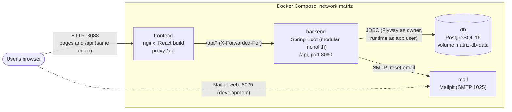
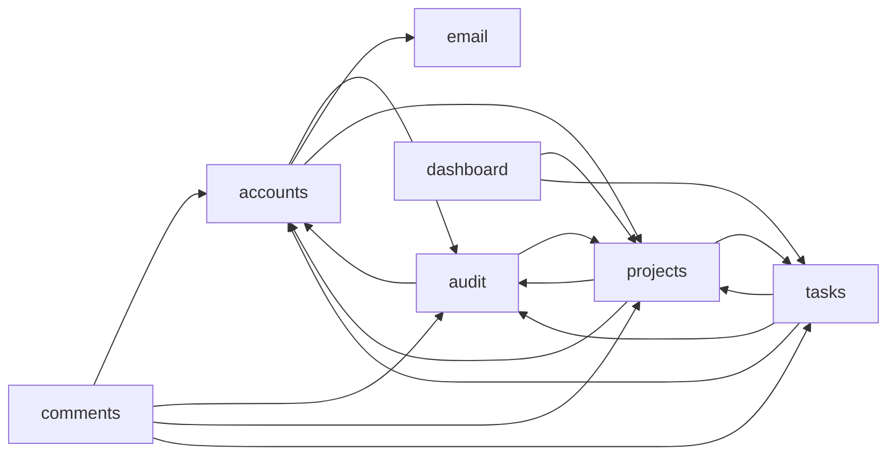
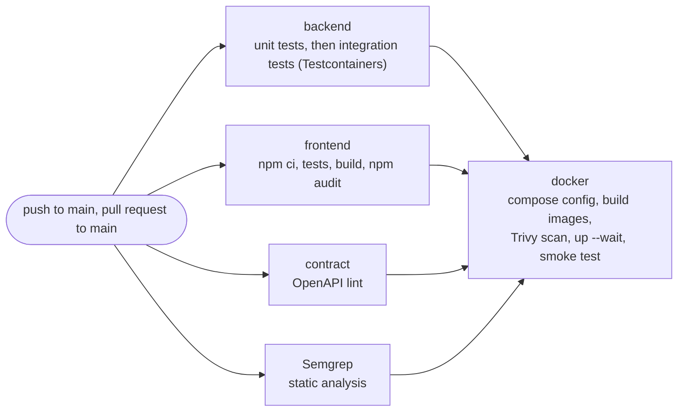

# Architecture — Matriz (MVP)

> Legend: **[D]** confirmed decision · **[A]** assumption (to be confirmed) · **[P]** pending decision.
> Based on [requirements.md](requirements.md), [user-stories.md](user-stories.md) and [constraints.md](constraints.md).

## 1. Drivers

- Small MVP scope: FR1–FR13, one company (A16), at least 50 users and 1,000 tasks (NFR2, A15).
- All permissions enforced on the server (NFR4); project roles drive most rules.
- Small team, course timeline; the code is written with AI assistants in Worksheet 03.
- Simple to run locally and to test.

## 2. Options compared

| Criterion | Monolith | Modular monolith | Microservices |
|---|---|---|---|
| Fit for MVP size | Good | Good | Poor: far more than the scope needs |
| Deployment | One unit | One unit | Many services, gateway, service discovery |
| Data consistency | One database, local transactions | One database, local transactions | Distributed data; cascade deletes (A11) and member checks cross services |
| Internal structure | Risk of tangled code as it grows | Clear module boundaries | Strong boundaries, high cost |
| Testing and debugging | Simple | Simple | Hard (network, contracts, many processes) |
| Path to grow | Refactor needed later | Modules can be split out later | Already split |
| Operating cost | Low | Low | High |

## 3. Decision: modular monolith

**[D] One Spring Boot application, split into business modules, with one PostgreSQL database.** Approved in Worksheet 02.

### Why this option

1. **Size:** the MVP has 13 functional requirements (FR1–FR13), one company (A16) and at least 50 users and 1,000 tasks (NFR2). One application handles this load without scaling out.
2. **One deployment:** one backend, one frontend build and one database to run, locally and in the course environment.
3. **Data consistency:** one database gives local transactions for rules that touch several areas, such as deleting a project with its tasks and comments (A11) or removing a member from their tasks (E1).
4. **Simpler security:** authorization (NFR4) is checked in one process, with no tokens passed between services.
5. **Organised code:** module boundaries (accounts, projects, tasks, comments, dashboard) keep the code readable for the team and for AI assistants, which a plain monolith does not enforce.
6. **Room to grow:** a module can be extracted into a service later if a real need appears.

### Why not the others

- **Monolith (no modules):** works for the MVP, but nothing stops the code from becoming tangled.
- **Microservices:** separate deployments, a gateway, data spread across services and network calls between them. That cost brings no benefit at this scale.

## 4. Technology stack

| Layer | Choice | Status | Justification |
|---|---|---|---|
| Backend | Java 21 + Spring Boot 3.5 (REST API), built with Maven | [D] | Mature, strong support for validation (Bean Validation), security (Spring Security) and data access (Spring Data JPA); fits the team's preference. |
| Frontend | React 18 (single-page application) with Vite, React Router and react-i18next; API address from `VITE_API_URL` | [D] | Team preference; fits a few screens with forms, lists and filters. |
| Database | PostgreSQL 16 | [D] | Relational data with clear relations (projects, members, tasks, assignees, comments) and constraints (unique email, no duplicate assignees); built-in text search is enough for FR10. |
| API contract | REST + JSON, described in OpenAPI 3.1 (`openapi.yaml`) | [D] | Shared contract between frontend and backend. |
| Authentication | Server-side session with an HttpOnly cookie (Spring Security) | [D] | Must be the simplest option. Spring Security's default session gives login, logout and the 30-minute inactivity timeout (A18) with no extra infrastructure; no tokens stored in the browser. Alternative: JWT. |
| Password hashing | BCrypt (Spring Security) | [A] | Meets NFR3. |
| Schema migrations | Flyway | [D] | Versioned schema. Demo accounts and demo projects are seeded only in the development profile (separate Flyway location, applied once, never wiping data); the Admin account is created at first start from environment variables (A25). |
| Tests | JUnit 5, Spring Boot Test, Testcontainers (PostgreSQL); Vitest and Testing Library in the frontend | [D] | Isolated and repeatable database for integration tests; prepares Worksheet 04. |
| Local runtime | Docker Compose (`compose.yaml`): PostgreSQL, Mailpit, backend and frontend images; or PostgreSQL and Mailpit only, with backend and frontend run locally for development | [D] | Simple; configuration only through environment variables, with a `.env.example` of fictitious values. Whole application in containers since Worksheet 05. |
| Container images | Backend: Eclipse Temurin 21 JRE (Ubuntu 22.04), non-root. Frontend: built with Node 24, served by nginx (unprivileged, Alpine), which also forwards `/api` to the backend | [D] | Worksheet 05. nginx keeps one origin for the browser (session and CSRF cookies), as the Vite proxy does in development; no change to the application. |
| Continuous integration | GitHub Actions (`.github/workflows/ci.yml`): tests, build, contract lint, Semgrep, Docker images, Trivy scan, smoke test | [D] | Worksheet 05. Read-only permissions, no secrets. |

## 5. Components and responsibilities

```
React SPA (responsive; pt-PT and en UI)
      │  HTTPS, JSON (REST)
      ▼
Spring Boot application (modular monolith)
  ├── web / api layer ──── controllers, request validation, error format (NFR5)
  ├── security ─────────── authentication, sessions, login lockout, authorization checks
  ├── accounts module ──── users, account roles, deactivation, password reset
  ├── audit module ─────── append-only logs: user changes and project activity
  ├── email adapter ────── sends the password reset email (SMTP)
  ├── projects module ──── projects, project members, project roles
  ├── tasks module ─────── tasks, assignees, search and filters
  ├── comments module ──── task comments
  └── dashboard module ─── task counts per status (read-only)
      │  JPA / SQL
      ▼
PostgreSQL
```

| Component | Responsibilities | Requirements |
|---|---|---|
| Frontend (React SPA) | Responsive screens for desktop and mobile browsers; texts in European Portuguese and English (translation files), including the labels for status, priority and roles; light and dark themes (CSS variables) with WCAG AA contrast; forms and client-side validation (for usability only), confirmation before destructive actions, redirect to login when not authenticated. | NFR1, NFR6–NFR8, US1 |
| API layer | REST endpoints, input validation, consistent error responses without internal details, HTTP status codes. | NFR5 |
| Security | Login and logout, session timeout, lockout after 5 failed attempts, generic login error, per-request authorization (account role and project role). | FR1, NFR3, NFR4, A17, A18 |
| Accounts | Admin creates, deactivates, reactivates and anonymises accounts; unique email; password reset with single-use tokens; own password change, forced at first login after an Admin-set password; creation of the pre-created accounts. | FR1a–FR1e, FR12, US9 |
| Audit | Records every change to a user's account or memberships (read by the Admin) and every change inside a project (read by its Managers), in the same transaction as the change. | FR1d, FR13 |
| Email adapter | Sends the reset email through SMTP, using plain-text messages in European Portuguese and English (in the backend) chosen by `users.locale`; behind an interface so the provider can change. | FR1c, NFR1 |
| Projects | Project CRUD by Managers, membership, promote and demote, at least one Manager per project, visibility limited to members. | FR2–FR4, E4, E6 |
| Tasks | Task CRUD with defaults (TODO, MEDIUM), delete rules, several assignees who must be members, search and filters. | FR5–FR8, FR10, E1, E5 |
| Comments | Add and list comments with author and date; no edit or delete. | FR11, A14 |
| Dashboard | For each project of the user, task counts per status, plus totals across those projects. | FR9, E2 |
| Database | Persistence, integrity constraints, cascade delete of a project's tasks and comments. | A11 |

### Diagrams

Components and how they communicate (whole application with Docker Compose, Worksheet 05):



In development mode the Vite dev server (port 5173) takes the place of nginx, and the backend runs with `./mvnw` on port 8080; `db` and `mail` still come from Compose.

Backend packages (`backend/src/main/java/pt/matriz`) and which other packages each one imports, read from the code on 2026-11-17. Every package also uses `web` (shared validation, error format) and `security` (current user); those arrows are left out. Controllers live inside each module package.



Fact: some packages import each other (for example `projects` and `tasks`, `accounts` and `audit`). Whether every such import goes through a service rather than a repository (module rule below) was not checked in Worksheet 05.

Continuous integration pipeline (`.github/workflows/ci.yml`):



### Module rules [D]

- Each module owns its own tables; other modules use its service interface, not its repositories.
- Authorization is checked in the backend services, never only in the frontend (NFR4).
- Frontend and backend communicate only through the documented REST API.

## 6. Assumptions

- [A] The frontend is a separate React build served as static files; in development it calls the backend through a proxy.
- [A] One environment for the course (local); demo accounts exist only outside production.
- [A] No caching, message queues or background jobs are needed for NFR2.
- [A] The API returns codes (enum values, error codes), never translated text; screen translations live in the frontend. The only translated text in the backend is the password reset email.

## 7. Pending decisions

Single list of pending technical decisions (constraints.md links here).

Decided in Worksheet 03 (docs/implementation-plan.md, section 7): versions, build tools, local runtime, testing strategy, repository layout, pagination and how pre-created account passwords are provided (see section 4).

- [P] Hosting beyond the local environment. Worksheet 05 prepared the images, Compose and CI, but no deployment target was chosen; not needed for the worksheet.
- [D] End-to-end tests with Playwright and an axe-core accessibility audit, adopted in Worksheet 03, Ex. 8 (`frontend/e2e`); Worksheet 04 can extend them.
- [D] Reset email in development: Mailpit (local SMTP test server in `compose.yaml`, renamed from `docker-compose.yml` in Worksheet 05), Worksheet 03, Ex. 8.
- [P] SMTP provider and sender address for production.
