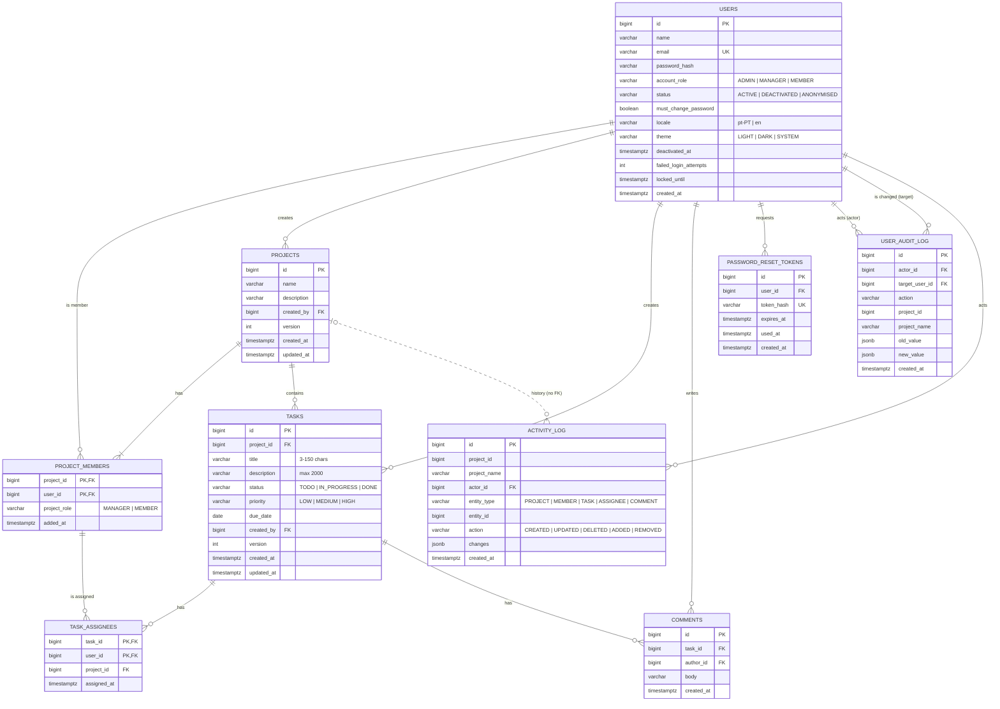

# Database — Matriz (MVP)

> Legend: **[D]** confirmed decision · **[A]** assumption (to be confirmed) · **[P]** pending decision.
> Database: PostgreSQL ([architecture.md](architecture.md)). Requirements in [requirements.md](requirements.md).

## 1. Entities

| Entity | Purpose | Requirements |
|---|---|---|
| `users` | User accounts, account role and account status. | FR1, FR1a, FR1b, FR12 |
| `projects` | Projects. | FR2 |
| `project_members` | Membership of a user in a project, with the project role. Basis for authorization. | FR3, FR4, A1 |
| `tasks` | Tasks of a project. | FR5–FR7 |
| `task_assignees` | Assignees of a task (many-to-many between tasks and project members). | FR8 |
| `comments` | Comments on a task, with author and date. | FR11 |
| `password_reset_tokens` | Single-use, time-limited password reset tokens. | FR1c |
| `user_audit_log` | Append-only record of every change to a user's account or memberships. | FR1d |
| `activity_log` | Append-only record of every change inside a project (project, members, tasks, assignees, comments). | FR13 |

### Requirements coverage

| Requirement | Tables | Note |
|---|---|---|
| FR1 login, lockout (A17) | users | `password_hash`, `failed_login_attempts`, `locked_until`, `status` |
| FR1a Admin creates accounts | users | `account_role`, unique email |
| FR1b Admin deactivates and anonymises accounts | users | `status`, `deactivated_at` |
| FR1e own password change | users | `must_change_password` |
| FR1c password recovery | password_reset_tokens, users | |
| FR1d user audit log | user_audit_log | |
| FR13 project activity log | activity_log | |
| FR2 projects | projects | |
| FR3 members and roles | project_members | `project_role` |
| FR4 visibility | project_members | a project is visible only with a membership row |
| FR5–FR7 tasks, status, priority | tasks | defaults and `CHECK` constraints |
| FR8 several assignees | task_assignees | |
| FR9 dashboard | tasks, project_members | count by `status` per project of the user; no table needed |
| FR10 search and filters | tasks, task_assignees, projects | query, no table needed; project search by name within the user's projects |
| FR11 comments | comments | |
| FR12 pre-created accounts | users, projects, project_members, tasks | Admin from environment variables at first start; demo accounts, 2 demo projects and their tasks seeded only in development (A25) |

Every requirement is covered; no other entity is needed for the MVP. Sessions are not stored in the database (see section 7).

### CRUD per entity

| Entity | Create | Read | Update | Delete |
|---|---|---|---|---|
| users | Admin | own profile; names of active members in shared projects; Admin sees all | Admin: deactivate, reactivate, new initial password | never deleted |
| projects | Manager account | members | project Managers | project Managers (cascade) |
| project_members | project Managers, Admin (appoint Manager) | members, Admin | project Managers, Admin (appoint Manager) | project Managers |
| tasks | members | members | members | project Managers or creator |
| task_assignees | members | members | — | members |
| comments | members | members | — (A14) | only by project cascade (A14) |
| password_reset_tokens | system, on request | system | system (mark as used) | — (kept until cleanup [A]) |
| user_audit_log | system, in the same transaction as the change | Admin | never | never |
| activity_log | system, in the same transaction as the change | project Managers | never | never |

## 2. Attributes

Conventions [A]: primary keys are `bigint` identity columns; timestamps are `timestamptz` in UTC; enumerations are stored as `varchar` with a `CHECK` constraint.

### users
| Column | Type | Rules |
|---|---|---|
| id | bigint | PK |
| name | varchar(100) [A] | mandatory, not only spaces; `NULL` only when `status = ANONYMISED` |
| email | varchar(254) | mandatory; unique, case-insensitive (`UNIQUE (lower(email))`), across all accounts — US9; replaced by `removed-<id>@invalid` when anonymised |
| password_hash | varchar(100) | BCrypt hash, never plain text — NFR3; `NULL` only when anonymised |
| must_change_password | boolean | default `true`; set when the Admin sets the password; cleared when the user changes it — FR1e. The development seed creates the demo accounts with `false` (A25) |
| account_role | varchar(10) | `ADMIN`, `MANAGER` or `MEMBER` — FR1a |
| status | varchar(15) | `ACTIVE`, `DEACTIVATED` or `ANONYMISED`; default `ACTIVE` — FR1b |
| locale | varchar(5) | interface language: `pt-PT` or `en`; default `pt-PT` — NFR1 |
| theme | varchar(6) | `LIGHT`, `DARK` or `SYSTEM`; default `SYSTEM` — NFR8 |
| deactivated_at | timestamptz | nullable; set when deactivated |
| failed_login_attempts | integer | default 0 — A17 |
| locked_until | timestamptz | nullable — A17 |
| created_at | timestamptz | mandatory |

### projects
| Column | Type | Rules |
|---|---|---|
| id | bigint | PK |
| name | varchar(100) [A] | mandatory, not only spaces — FR2 |
| description | varchar(2000) [A] | optional |
| created_by | bigint | FK → users.id (never deleted, so always valid) |
| version | integer | optimistic locking |
| created_at, updated_at | timestamptz | mandatory |

### project_members
| Column | Type | Rules |
|---|---|---|
| project_id | bigint | PK part, FK → projects.id, `ON DELETE CASCADE` |
| user_id | bigint | PK part, FK → users.id |
| project_role | varchar(10) | `MANAGER` or `MEMBER` — A1 |
| added_at | timestamptz | mandatory |

PK (`project_id`, `user_id`): a user is a member of a project at most once.

### tasks
| Column | Type | Rules |
|---|---|---|
| id | bigint | PK; `UNIQUE (id, project_id)` for the assignee FK |
| project_id | bigint | FK → projects.id, `ON DELETE CASCADE` — A11 |
| title | varchar(150) | mandatory, 3 to 150 characters after trimming — FR5, A6 |
| description | varchar(2000) | optional — A20 |
| status | varchar(15) | `TODO`, `IN_PROGRESS`, `DONE`; default `TODO` — FR6, A5 |
| priority | varchar(10) | `LOW`, `MEDIUM`, `HIGH`; default `MEDIUM` — FR7, A5 |
| due_date | date | optional, any date — A19 |
| created_by | bigint | FK → users.id; used for the delete rule — A10 |
| version | integer | optimistic locking |
| created_at, updated_at | timestamptz | mandatory |

### task_assignees
| Column | Type | Rules |
|---|---|---|
| task_id | bigint | PK part |
| user_id | bigint | PK part |
| project_id | bigint | copy of the task's project, used only by the foreign keys below |
| assigned_at | timestamptz | mandatory |

- PK (`task_id`, `user_id`): the same user cannot be assigned twice to a task.
- FK (`task_id`, `project_id`) → tasks (`id`, `project_id`), `ON DELETE CASCADE`: the assignee row always belongs to the task's project.
- FK (`project_id`, `user_id`) → project_members, `ON DELETE CASCADE`: only project members can be assigned (FR8, US4); removing a member removes their assignments while the tasks stay (E1).

### comments
| Column | Type | Rules |
|---|---|---|
| id | bigint | PK |
| task_id | bigint | FK → tasks.id, `ON DELETE CASCADE` — A11 |
| author_id | bigint | FK → users.id (never deleted, so always valid) |
| body | varchar(2000) [A] | mandatory, plain text, not only spaces |
| created_at | timestamptz | mandatory; shown as the comment date — US7 |

No `updated_at`: comments cannot be edited or deleted (A14).

### password_reset_tokens
| Column | Type | Rules |
|---|---|---|
| id | bigint | PK |
| user_id | bigint | FK → users.id |
| token_hash | varchar(100) | mandatory, unique; SHA-256 of the token sent by email; the token itself is never stored — NFR3 |
| expires_at | timestamptz | mandatory; 30 minutes after creation — A22 |
| used_at | timestamptz | nullable; set when used |
| created_at | timestamptz | mandatory |

### user_audit_log
| Column | Type | Rules |
|---|---|---|
| id | bigint | PK |
| actor_id | bigint | nullable FK → users.id; who made the change; `NULL` for system actions (seed data) |
| target_user_id | bigint | FK → users.id; whose data changed |
| action | varchar(30) | see list below |
| project_id | bigint | nullable; project concerned, no FK so the entry survives a project delete |
| project_name | varchar(100) | nullable; copy of the project name at the time |
| old_value | jsonb | nullable; values before the change (non-personal fields only) |
| new_value | jsonb | nullable; values after the change (non-personal fields only) |
| created_at | timestamptz | mandatory |

Actions: `ACCOUNT_CREATED`, `ACCOUNT_DEACTIVATED`, `ACCOUNT_REACTIVATED`, `ACCOUNT_ANONYMISED`, `PASSWORD_SET_BY_ADMIN`, `PASSWORD_CHANGED`, `PASSWORD_RESET_REQUESTED`, `PASSWORD_RESET_COMPLETED`, `MEMBER_ADDED`, `MEMBER_REMOVED`, `PROJECT_ROLE_CHANGED`, `MANAGER_APPOINTED`, `ACCOUNT_LOCKED`, `PREFERENCES_CHANGED` (language or theme).

- Passwords, hashes and tokens are never written to `old_value` or `new_value` (only the fact that the password changed).
- [D] Personal data (name, email) is never written as a value: only the names of the changed fields, e.g. `{"fields": ["name"]}`. People are shown by joining `actor_id` and `target_user_id` with `users`, so anonymising an account also anonymises every log entry (R1). The same rule applies to `activity_log`.
- Append-only: the application's database user has `INSERT` and `SELECT` only on this table [A].
- Removals caused by a project delete or by a deactivation are logged one entry per membership.

### activity_log
| Column | Type | Rules |
|---|---|---|
| id | bigint | PK |
| project_id | bigint | project where the change happened; no FK, so entries survive a project delete |
| project_name | varchar(100) | copy of the project name at the time |
| actor_id | bigint | FK → users.id; who made the change |
| entity_type | varchar(15) | `PROJECT`, `MEMBER`, `TASK`, `ASSIGNEE`, `COMMENT` |
| entity_id | bigint | id of the changed row (task id, comment id, user id for members and assignees) |
| action | varchar(15) | `CREATED`, `UPDATED`, `DELETED`, `ADDED`, `REMOVED` |
| changes | jsonb | nullable; changed fields with old and new values, e.g. `{"status": {"old": "TODO", "new": "DONE"}}` |
| created_at | timestamptz | mandatory |

- Written by the backend in every write operation, in the same transaction as the change; no change without an entry.
- Append-only, like `user_audit_log`: the application's database user has `INSERT` and `SELECT` only [A].
- Comment text is not copied into `changes` (the comment row keeps it); a deleted task keeps its title in `changes` so the entry stays readable.
- Membership changes are written to both logs: `user_audit_log` (the user's history, for the Admin) and `activity_log` (the project's history, for its Managers) [D].
- Index on (`project_id`, `created_at`).
- [D] The activity of a deleted project is kept for the record but nobody reads it through the API in the MVP.

## 3. Relationships and cardinalities

| Relationship | Cardinality | Notes |
|---|---|---|
| users – project_members – projects | N:M | A user belongs to 0..N projects; a project has 1..N members. |
| projects – tasks | 1:N | A project has 0..N tasks; a task belongs to exactly 1 project. |
| tasks – task_assignees – project_members | N:M | A task has 0..N assignees; a member is assigned to 0..N tasks. |
| tasks – comments | 1:N | A task has 0..N comments. |
| users – comments | 1:N | A comment has exactly 1 author. |
| users – tasks (created_by) | 1:N | A task has exactly 1 creator. |
| users – projects (created_by) | 1:N | A project has exactly 1 creator. |
| users – password_reset_tokens | 1:N | A user has 0..N tokens; at most one unused and valid at a time. |
| users – user_audit_log | 1:N (twice) | As actor (0..1 per entry) and as target (exactly 1 per entry). |
| users – activity_log | 1:N | Each entry has exactly 1 actor. |
| projects – activity_log | 1:N, no FK | Entries keep `project_id` after the project is deleted. |

## 4. ER diagram

## 5. Users who leave the company [D]

- Accounts are never deleted. The Admin **deactivates** the account (`status = DEACTIVATED`, `deactivated_at` set).
- A deactivated user cannot log in (same generic error as a wrong password); their open sessions stop working, because the backend checks the account status on every request.
- Deactivation removes the user from all projects (their `project_members` rows), so their assignments are removed too (E1). Tasks they created and comments they wrote stay.
- [A] Deactivated users are hidden from every list, selector and search (project members, assignees, assignee filter). They appear only:
  - next to their past work (task creator, comment author) as "Name (left the company)", translated into the user's language (NFR1); the label comes from `status`, it is not stored as text;
  - in the Admin's account list, with an "Inactive" filter.
- **Returning person, same email:** the Admin reactivates the same account and sets a new initial password [A]. Project memberships are not restored; a Manager or the Admin adds them again.
- **New access with a different email:** the Admin creates a new account. It has no link to the old one.
- **New account with the email of a deactivated account:** refused (unique email); the Admin reactivates instead (D1).
- If the user is the only Manager of a project, the Admin first appoints another Manager there; then the deactivation is allowed (D5).

### Anonymisation (GDPR erasure) [D]

- On request, the Admin anonymises a **deactivated** account: `name` set to `NULL`, `email` to `removed-<id>@invalid`, `password_hash` to `NULL`, `status = ANONYMISED`. It cannot be undone.
- Tasks and comments stay; the interface shows "Removed user" ("Utilizador removido") as their author or creator. Comment text is not changed [A].
- The logs keep only ids, so they show "Removed user" too.

## 6. Error and edge cases

Responses: **400** malformed request (invalid JSON, unknown field, non-numeric id); **401** not authenticated; **403** authenticated but not allowed; **404** resource does not exist or the user is not a member of its project (it does not reveal that it exists, E4); **409** duplicate or conflicting state; **422** well-formed request that breaks a rule, including a wrong type or `null` where not allowed; **500** unexpected error with a generic message, no internal details (NFR5).

### Accounts and login

| # | Case | Rule | Enforced by | Response |
|---|---|---|---|---|
| D1 | Account created with an email that already exists (any case, active or deactivated), including two Admins creating it at the same time | Refused; for a returning person, reactivate | DB unique index + backend | 409 |
| D2 | Manager or Member account tries to create, deactivate or reactivate accounts | Refused | backend (account role) | 403 |
| D3 | Deactivating an already deactivated account, or reactivating an active one | Refused | backend | 409 |
| D4 | Admin deactivates their own account, or the last active Admin | Refused | backend | 409 |
| D44 | Anonymising an active account, or reactivating an anonymised one | Refused (deactivate first; anonymisation is final) | backend | 409 |
| D45 | User with `must_change_password` calls anything other than change password or logout | Refused until the password is changed | backend | 403 |
| D46 | Own password change with a wrong current password | Refused; counts as a failed login attempt (A17) | backend | 422 |
| D47 | New password equal to the current one, or shorter than 8 characters (A21) | Refused | backend | 422 |
| D48 | Successful own password change | Flag cleared, other sessions ended, audit entry written | backend, one transaction | 204 |
| D5 | Deactivating a user who is the only Manager of a project | Refused until another Manager is appointed (the Admin can do it, D12) | backend | 409 |
| D6 | Wrong email or password, or deactivated account, at login | Same generic error; does not reveal whether the email exists or its status | backend | 401 |
| D7 | 5 failed logins in a row (A17) | Locked for 15 minutes, even with the correct password; counter resets after a successful login | backend | 401 |
| D8 | Not logged in, session expired (A18) or account deactivated during the session | Refused; the interface redirects to login | backend (Spring Security, status checked per request) | 401 |

### Password recovery

| # | Case | Rule | Enforced by | Response |
|---|---|---|---|---|
| D30 | Reset requested for an email that does not exist or a deactivated account | Same answer as for a valid email; no email sent | backend | 202 |
| D31 | More than 3 reset requests for one email in an hour (A22) | No more emails sent; same answer | backend | 202 |
| D32 | Reset link expired, already used or invalid | Refused, generic message; the user can request a new link | backend | 422 |
| D33 | New reset requested while an older link is still valid | Older links are invalidated; only the newest works | backend | 202 |
| D34 | Successful reset | Token marked used, other tokens invalidated, lock and failed attempts cleared, other sessions of the user ended, audit entry written | backend, one transaction | 200 |
| D35 | New password shorter than 8 characters (A21) | Refused | backend | 422 |
| D36 | Email server unavailable | Request still answered the same way; failure logged without the token; the user can try again | backend | 202 |

### Audit

| # | Case | Rule | Enforced by | Response |
|---|---|---|---|---|
| D37 | Writing the audit entry fails | The change itself is rolled back (same transaction); no change without a record | DB transaction | 500 |
| D38 | Manager or Member tries to read the audit log | Refused | backend | 403 |
| D39 | Anyone tries to change or delete an audit entry | Not possible: no API operation, and the database user has no `UPDATE` or `DELETE` on the table | DB permissions | — |
| D40 | Writing the activity entry fails | The change itself is rolled back (same transaction) | DB transaction | 500 |
| D41 | Member (not Manager) or Admin tries to read a project's activity log | Refused | backend | 403 |
| D42 | Non-member tries to read a project's activity log | Refused without revealing the project | backend | 404 |
| D43 | Update with no real change (same values) | Saved without a new `version` and without an activity entry | backend | 200 |

### Projects and members

| # | Case | Rule | Enforced by | Response |
|---|---|---|---|---|
| D9 | Member account tries to create a project | Refused | backend (account role) | 403 |
| D10 | Member of the project tries a Manager-only action (edit or delete project, manage members) | Refused | backend (project role) | 403 |
| D11 | Admin tries to open tasks or comments, or edit or delete a project | Refused | backend | 403 |
| D12 | Admin or Manager appoints a Manager | Allowed for any active, non-Admin user; adds the user to the project if needed, otherwise changes their role | backend | 200 |
| D13 | Member added twice to a project, including at the same time | Refused | DB PK | 409 |
| D14 | Adding or appointing a deactivated user or the Admin account | Refused | backend | 422 |
| D15 | Removed member added again | Allowed: new membership row; old assignments are not restored | DB PK (old row was deleted) | 201 |
| D16 | Removing or demoting the last Manager (E6), including two Managers demoting each other at the same time | Refused | backend, with a row lock on the project | 409 |
| D17 | Non-member opens a project, task or comment by URL or API (E4) | Refused without revealing content | backend (membership check on every request) | 404 |
| D18 | Removed member still has a page open | Next request refused | backend (membership not cached in the session) | 404 |
| D19 | Reactivated user logs in | Sees no projects until added again (FR4) | backend | 200 |

### Tasks, assignees and comments

| # | Case | Rule | Enforced by | Response |
|---|---|---|---|---|
| D20 | Title outside 3 to 150 characters or only spaces; description over 2,000; empty comment; invalid status or priority | Refused, with the field flagged | backend + DB `CHECK` | 422 |
| D21 | Same user assigned twice to a task | Refused | DB PK | 409 |
| D22 | Assigning a user who is not a project member or is deactivated, including a member removed at the same moment | Refused | DB FK + backend | 422 |
| D23 | Member deletes a task they did not create | Refused; editing is allowed (A13) | backend | 403 |
| D24 | Task creator is no longer a member | Cannot delete it (no access); Managers still can | backend | 404 for the former member |
| D25 | Two users edit the same task or project at the same time | Second save refused; the user reloads and retries | DB `version` column (optimistic locking) | 409 |
| D26 | Task or project deleted while another user is viewing, editing or commenting | The next request finds nothing | DB | 404 |
| D27 | Moving a task to another project | Not allowed in the MVP: `projectId` is not an accepted field in an update | API validation | 400 |
| D49 | Control character (U+0000 to U+001F or U+007F) in a text field | Titles, project and account names, and emails created by the Admin accept none; task and project descriptions and comments accept only tab, line feed and carriage return. Spaces at the edges are trimmed first (A6). Approved by David, 2026-11-17 (Worksheet 05) | backend (`TextInput`) | 422 `INVALID_CHARACTER` |

### System failures

| # | Case | Rule | Enforced by | Response |
|---|---|---|---|---|
| D28 | Database unavailable or unexpected error | Transaction rolled back, nothing saved halfway; generic message; details only in server logs, without personal data or passwords | backend | 500 |
| D29 | Failure in the middle of a multi-step change (e.g. deactivation, project delete) | Whole change in one transaction | DB transaction | 500, no partial change |

New users and users added later are not affected by existing data: their access depends only on their own rows, old rows are never reused, and a returning person is reactivated rather than duplicated.

## 7. Assumptions

- [A] `bigint` identity keys (simple, enough for NFR2). Alternative: UUID, which hides how many records exist.
- [A] Titles are trimmed before saving; the length rule applies to the trimmed value.
- [A] Field lengths not set by the requirements (user and project name 100, comment 2,000).
- [A] Search (FR10) uses case-insensitive `ILIKE` on task title and description and on project name (within the user's projects); enough for 1,000 tasks, no extra index. Index on `tasks (project_id, status)` for the dashboard (FR9).
- [D] Development seed (A25): a Flyway migration in a `dev`-only location, so it runs once and never wipes data. It creates the demo Manager and Member accounts (`must_change_password = false`, fictitious data, passwords from environment variables), 2 demo projects (one with both demo users, one with the Manager only) and a few tasks in each status. Approved in docs/implementation-plan.md (M1–M3).
- [A] The Admin account is never a project member; it sees project names and members (to appoint Managers) but not tasks or comments.
- [A] Expired and used reset tokens are deleted after 30 days; the audit log is kept indefinitely.
- [A] The reset email is sent during the request (no queue); fine at this scale.
- [A] Sessions are kept in the application's memory (Spring Security default), not in the database; a restart logs everyone out.

## 8. Pending decisions

- [D] Pagination of project and task lists: `page`, `size` (max 100), `totalItems` (openapi.yaml; implementation-plan.md P7).
- [D] Endpoint to read a project's activity log (paginated, project Managers): `GET /projects/{projectId}/activity`, openapi.yaml 0.6.0 (Worksheet 03, Ex. 8).

- [P] How long the logs are kept (constraints.md, section 5).
