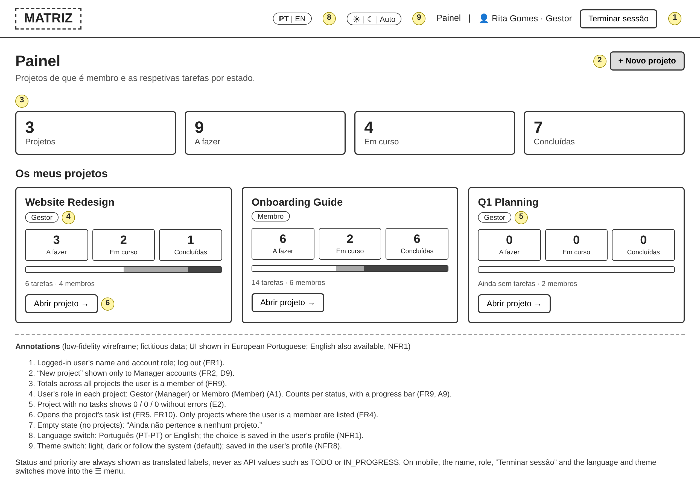
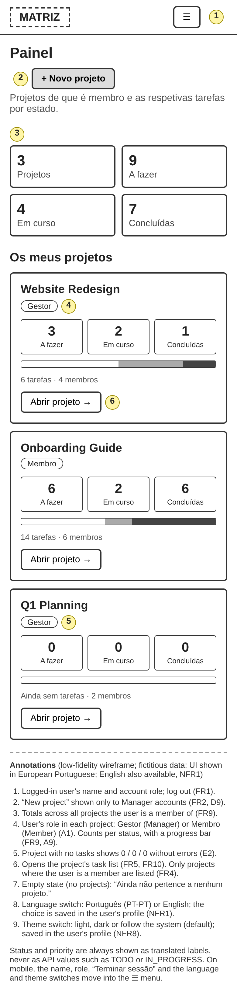
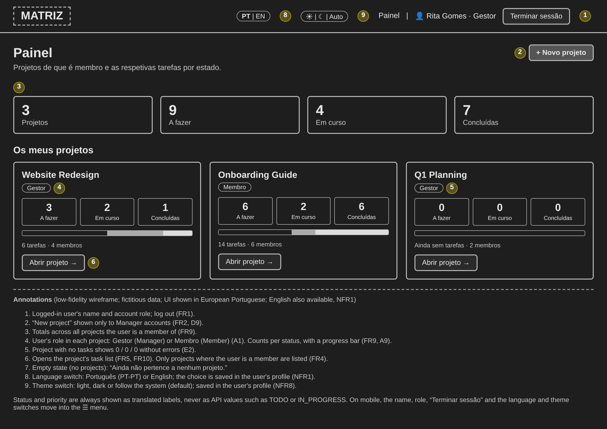
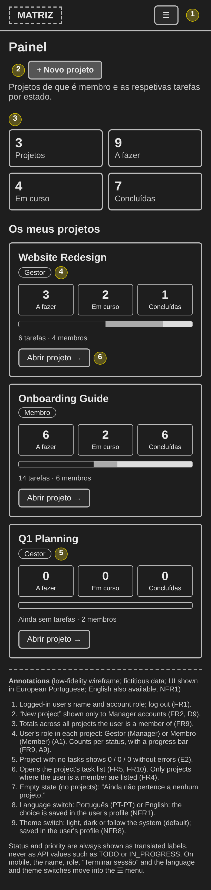

# Wireframe — Dashboard (home screen)

> Legend: **[D]** confirmed decision · **[A]** assumption (to be confirmed) · **[P]** pending decision.

Low-fidelity wireframe of the first screen after login for a Manager or Member account, in the desktop and mobile layouts of the same responsive web page (NFR7). Fictitious data. Shown in European Portuguese; the same screen is available in English (NFR1). Annotations in English. Source: [wireframe-source.html](wireframe-source.html), a static mock-up rendered to PNG.

| | Desktop (1280 px) | Mobile (390 px) |
|---|---|---|
| Light |  |  |
| Dark |  |  |

## Elements

| # | Element | Requirements |
|---|---|---|
| 1 | Header: user's name and account role, "Terminar sessão" (log out); on mobile inside the ☰ menu | FR1, NFR7 |
| 2 | "+ Novo projeto" button, shown only to Manager accounts | FR2, D9 |
| 3 | Totals: number of projects and tasks per status across the user's projects | FR9 |
| 4 | One card per project: name, the user's role in it, counts per status, progress bar, number of tasks and members | FR9, A1, A9 |
| 5 | Project with no tasks shows 0 / 0 / 0 | E2 |
| 6 | "Abrir projeto" opens the project page: task list with search and filters, and, for Managers, the project's activity log | FR5, FR10, FR13 |
| 7 | Empty state: "Ainda não pertence a nenhum projeto." | FR4 |
| 8 | Language switch PT / EN; saved in the user's profile; on mobile inside the ☰ menu | NFR1 |
| 9 | Theme switch light / dark / Auto (follow the system, default); saved in the user's profile; on mobile inside the ☰ menu | NFR8 |
| 10 | Charts (UI polish, 2026-11-18): tasks per status and open tasks per priority, each bar with its value and share in text | FR9, NFR8 |
| 11 | "Prazos da semana": the seven days of a week with a dot per task due (colour by state), and the tasks due on the selected day; previous / next week and "Hoje" | FR5 (due date) |
| 12 | Each project bar shows the share of tasks done (%); "Progresso geral" and "Atalhos" share one row | FR9 |
| 13 | Animated background (drifting shapes in the palette colours) behind the tiles, as on the login page; still with reduced motion | NFR7, NFR8 |

## Labels for enumerated values [D]

The API and the database use codes; the interface always shows translated labels (NFR1).

| Code | Português (PT-PT) | English |
|---|---|---|
| `TODO` | A fazer | To do |
| `IN_PROGRESS` | Em curso | In progress |
| `DONE` | Concluída | Done |
| `LOW` | Baixa | Low |
| `MEDIUM` | Média | Medium |
| `HIGH` | Alta | High |
| `MANAGER` | Gestor | Manager |
| `MEMBER` | Membro | Member |
| `ADMIN` | Administrador | Administrator |

Plural forms (e.g. "Concluídas" in the counters) follow the same translation files.

## Validation against the MVP

- [D] Only projects where the user is a member are listed (FR4); counts come from the server.
- [D] The dashboard shows no actions the user cannot do: Members do not see "+ Novo projeto" (permissions are still enforced on the server, NFR4).
- [D] One responsive web page for desktop and mobile browsers; no native app (NFR7).
- [D] Light and dark themes; information is never conveyed by colour alone (counts always have a text label) (NFR8).
- [D] The project activity log is inside each project, not on the dashboard (FR13).
- No feature outside the MVP is shown (no kanban, notifications or due-date alerts; the weekly widget only lists the due dates that already exist).

## Assumptions

- [A] The PT-PT label for the Manager role is "Gestor" (English: "Manager").
- [A] The Admin account does not see this dashboard; after login it goes to the account management area (not drawn).
- [A] The totals row (element 3) and the progress bar are presentation extras on top of FR9.
- [A] Projects are sorted by name; no pagination is needed at the NFR2 scale.
- [A] Mobile layout: totals in a 2 × 2 grid, project cards stacked, user menu behind ☰; minimum width 360 px.
- [A] Navigation in the MVP: Painel → project (task list, activity log) → task detail.
- [A] "Em atraso" (overdue) in the weekly widget: due date before today and status other than DONE; computed by the interface (UI polish, 2026-11-18).
- [A] The priority chart counts only open tasks (TODO and IN_PROGRESS); done tasks need no attention.

## Pending decisions

- [D] Dashboard data: `GET /dashboard`; language and theme saved with `PATCH /auth/me/preferences` (openapi.yaml, Worksheet 03).
- [D] UI polish, approved 2026-11-18: `totals.priorityCounts` in `GET /dashboard` and `GET /dashboard/due-tasks?from&to` (at most 42 days) for the weekly widget (openapi.yaml 0.9.0); brighter palette in `tokens.css`, WCAG AA pairs listed in docs/verification.md (V-81).
- [D] Colour palette for both themes approved in Worksheet 03, Ex. 7 (`frontend/src/styles/tokens.css`); WCAG AA contrast checked, and no serious axe-core violation in either theme (Ex. 8).
